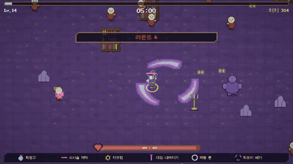
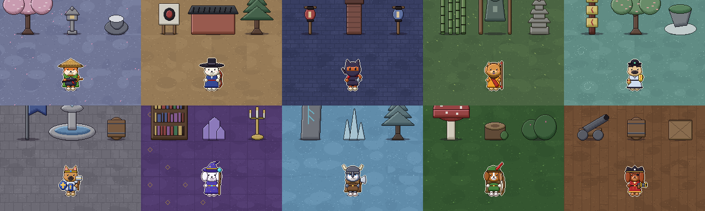
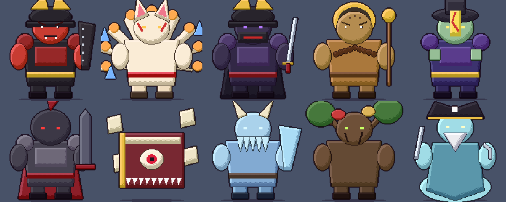

# SlayerDog

판타지 · 동양풍 직업 옷을 입은 개 영웅 열 마리가 열 개의 세계에서 몰려오는 침공군을 베는 **12분 서바이버(뱀서류)**. 스팀 PC 싱글 게임.

## 게임

| 항목 | 내용 |
|---|---|
| 장르 | 로그라이트 서바이버 · 불릿 헤븐 (도트 그래픽) |
| 한 판 | 12라운드 × 60초. 맵 보스를 쓰러뜨리면 클리어 |
| 조작 | 이동만. 공격은 자동 발동 · 자동 조준. ESC 일시정지 |
| 성장 | 레벨업마다 카드 3장 중 하나 — 새 무기 · 무기 강화 · 고유 공격 강화 · 능력치. 같은 계열 시너지, 무기 통달 |
| 영웅 | 10 — 시바 무사 · 진돗개 무관 · 아키타 닌자 · 차우차우 무승 · 퍼그 도사 · 셰퍼드 성기사 · 푸들 대마법사 · 허스키 광전사 · 비글 레인저 · 닥스훈트 포수 |
| 세계 | 10 — 세계마다 바닥 · 소품 · 적 · 보스가 다르다. 세계를 깨면 그 세계 출신 영웅이 합류 |
| 필드 | 경험치 뼈, 무기 상자, 회복 고기, 자석 |
| 영구 성장 | 사료로 능력치 강화, 슈퍼 DNA 로 별자리 스킬 트리 |
| 언어 | 한국어 · 영어 |

## 만든 도구

Unity 6000.3 (URP) · 데이터 주도 스킬 시스템 · Python 절차 생성 도트 그래픽

## 크레딧

- 글꼴: 도스고딕 (이담허 leedheo, MIT) — https://github.com/hurss/fonts

## 라이선스

MIT. `LICENSE` 참고.
